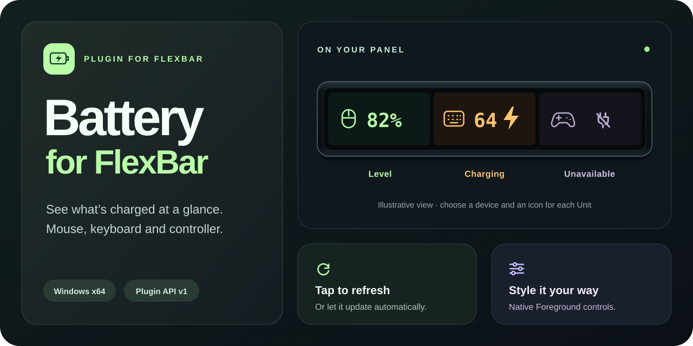

# Battery para FlexBar

[English](README.md) · [Русский](README.ru.md) · **Español** · [简体中文](README.zh-CN.md)

Consulta la batería de un ratón, teclado o mando en FlexBar. Añade una unidad
**Battery level** por dispositivo, selecciónalo en **Function** y configura el
tipo de letra, el color y el icono en **Foreground**.

[Instalación](docs/SETUP.md) · [Compatibilidad](docs/COMPATIBILITY.md) · [Compilar desde el código fuente](README.md#build-from-source)

- Muestra el porcentaje o un nivel discreto si no se dispone del porcentaje.
- Durante la carga, un rayo sustituye el signo `%`. Cuando el dispositivo no
  está disponible, un enchufe tachado sustituye la lectura sin cambiar el icono elegido.
- La unidad se actualiza aproximadamente una vez por minuto. Tócala para
  actualizar antes.

Requiere Windows 10/11 (x64), FlexBar y FlexDesigner con **Plugin API v1**.
La versión de referencia verificada es **2.2.3**. Las pruebas de hardware de
2.2.5 Pre-release están pendientes. No es un plugin de FlexStudio SDK v2.

## Dispositivos compatibles

**Probados en hardware:** Logitech MX Master 4 (Logi Bolt), Logitech G305
LIGHTSPEED (receptor original), Keychron M6 (receptor Keychron Link 1K),
Lamzu Paro (receptor de 2,4 GHz y USB) y Sony DualSense (USB y Bluetooth con
informes ampliados; el porcentaje es estimado).

**Beta:** G502 LIGHTSPEED, Keychron M7 y otros perfiles Keychron RF, Lamzu
Aurora, modelos seleccionados de ratones y teclados, DualSense Edge,
DualShock 4, Switch Pro y mandos Xbox. También están en beta las lecturas
Bluetooth de Windows, HID estándar y HeadsetControl. Consulta
[la tabla de compatibilidad](docs/COMPATIBILITY.md) para ver modelos y conexiones.

Puedes descargar el paquete de [GitHub Releases](https://github.com/mor4ee/BatteryFlexBar/releases/latest)
e importarlo en FlexDesigner, o [compilarlo localmente](README.md#build-from-source).
El plugin no envía los datos de la batería a un servicio en la nube.

[Licencia MIT](LICENSE) · [Avisos de terceros](THIRD_PARTY_NOTICES.md).
