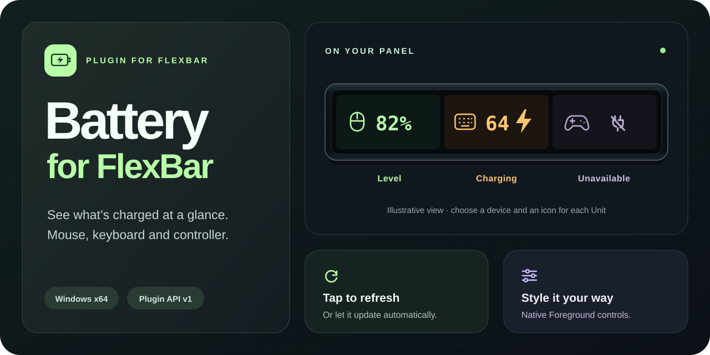

# Battery for FlexBar

**English** · [Русский](README.ru.md) · [Español](README.es.md) · [简体中文](README.zh-CN.md)



See the battery level of a mouse, keyboard or controller on your FlexBar. Add
one **Battery level** Unit per device, choose the device in **Function**, and
style its text and icon in **Foreground**.

[Setup](docs/SETUP.md) · [Compatibility](docs/COMPATIBILITY.md) · [Build from source](#build-from-source)

## On your FlexBar

- See the percentage, or a discrete level where the device only reports levels.
- A lightning icon replaces the percent sign during charging. When the device
  is unavailable, a crossed-out plug replaces the reading. Your chosen icon
  and style stay in place.
- The Unit refreshes about once a minute. Tap it to read again sooner.
- Monitor several devices at once by adding several Units.

## Requirements

Windows 10/11 (x64), FlexBar, and FlexDesigner **Plugin API v1**. The verified
host baseline is FlexDesigner **2.2.3**. The full hardware regression on 2.2.5
Pre-release is still pending. This is not a FlexStudio SDK v2 plugin.

MX Master 4 through Bolt, G305 through LIGHTSPEED, Keychron M6 through Keychron
Link, Lamzu Paro, and DualSense have been tested. Transport and model details
matter: see [the compatibility table](docs/COMPATIBILITY.md) for verified and
beta routes.

This branch is a release preview. Use a [GitHub Releases](https://github.com/mor4ee/BatteryFlexBar/releases)
asset when one is available, or build from source below.

## Build from source

From a clean checkout on Windows with Node.js 22.17+ and Windows PowerShell 5.1:

```powershell
npm ci
npm run native:restore
npm run typecheck
npm test
npm run build
.\native\bin\BatteryHidHelper.exe --self-test
npm run validate
npm run pack
npm run release:stage
```

Install the resulting `Battery.win32.x64.flexplugin` from `release/v<version>/`
through FlexDesigner. The build uses public npm and NuGet dependencies and does
not require FlexDesigner, hardware, or adjacent projects. The companion
`SHA256SUMS.txt` records the archive checksum.

## Privacy and license

Battery reads from Windows, local HID devices and, for the G305 fallback,
the local G HUB service. The plugin does not send battery data to a cloud
service. HeadsetControl and the extended DualSense Bluetooth report mode are
optional; see [setup](docs/SETUP.md).

[MIT License](LICENSE) · [Third-party notices](THIRD_PARTY_NOTICES.md) · [Security](SECURITY.md).
Battery is an independent community plugin.
