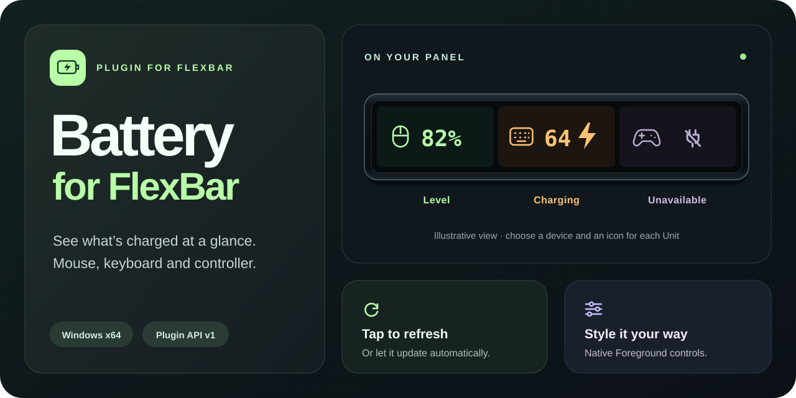

# Battery для FlexBar

[English](README.md) · **Русский** · [Español](README.es.md) · [简体中文](README.zh-CN.md)

Показывает заряд мыши, клавиатуры или геймпада на FlexBar. Добавьте по
одному юниту **Уровень заряда** на устройство, выберите устройство во
вкладке **Function**, а шрифт, цвет и иконку настройте во **Foreground**.

[Установка и настройка](docs/SETUP.md) · [Совместимость](docs/COMPATIBILITY.md) · [Сборка из исходников](README.md#build-from-source)

- Показывает проценты или дискретный уровень, если устройство не сообщает процент.
- При зарядке вместо `%` появляется молния. Когда устройство недоступно,
  показание заменяет перечёркнутая вилка. Выбранная иконка и оформление остаются.
- Данные обновляются примерно раз в минуту; тап запускает внеочередной опрос.
- Для нескольких устройств можно разместить несколько юнитов.

Нужны Windows 10/11 (x64), FlexBar и FlexDesigner с **Plugin API v1**.
Проверенная базовая версия — **2.2.3**. Полный тест на 2.2.5 Pre-release
ещё не проведён. FlexStudio SDK v2 не используется.

Основные проверенные устройства: Logitech MX Master 4 через Bolt и G305 через
LIGHTSPEED, Keychron M6 через Keychron Link, Lamzu Paro и DualSense.
Перед установкой сверьте модель и способ подключения с
[таблицей совместимости](docs/COMPATIBILITY.md): остальные маршруты отмечены как бета.

Готовый пакет можно будет скачать из [GitHub Releases](https://github.com/mor4ee/BatteryFlexBar/releases).
До публикации доступна [локальная сборка из исходников](README.md#build-from-source).
Данные читаются локально и не отправляются в облако.

[Лицензия MIT](LICENSE) · [Сторонние компоненты](THIRD_PARTY_NOTICES.md).
