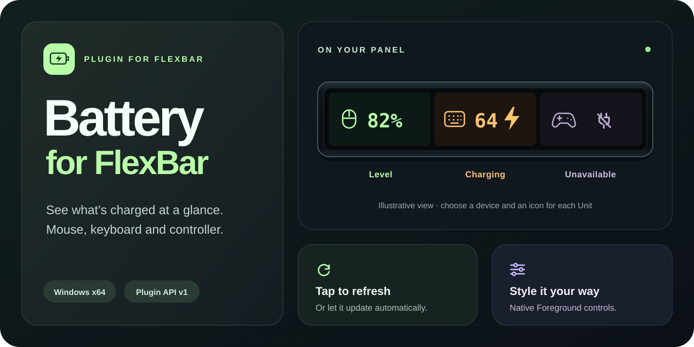

# Battery for FlexBar

[English](README.md) · [Русский](README.ru.md) · [Español](README.es.md) · **简体中文**

在 FlexBar 上查看鼠标、键盘或手柄的电量。每台设备添加一个
**Battery level** 单元，在 **Function** 中选择设备，然后在
**Foreground** 中设置字体、颜色和图标。

[安装指南](docs/SETUP.md) · [兼容性](docs/COMPATIBILITY.md) · [从源代码构建](README.md#build-from-source)

- 显示电量百分比。如果设备只提供分级电量，则显示对应等级。
- 充电时，闪电图标替代百分号。设备不可用时，读数会被划线插头图标替代，
  用户选择的图标和样式保持不变。
- 大约每分钟更新一次，也可以轻触单元立即刷新。

需要 Windows 10/11（x64）、FlexBar 和支持 **Plugin API v1** 的
FlexDesigner。已验证的基准版本是 **2.2.3**。2.2.5 预发布版仍需完整的硬件
回归测试。本插件不使用 FlexStudio SDK v2。

## 支持的设备

**已在硬件上测试：** Logitech MX Master 4（Logi Bolt）、Logitech G305
LIGHTSPEED（原装接收器）、Keychron M6（1K Keychron Link 接收器）、
Lamzu Paro（2.4 GHz 接收器和 USB）以及 Sony DualSense（USB 和启用扩展报告的
蓝牙连接；百分比为估算值）。

**Beta（测试版）：** G502 LIGHTSPEED、Keychron M7 和部分其他 Keychron RF 型号、
Lamzu Aurora、部分鼠标和键盘、DualSense Edge、DualShock 4、Switch Pro 和 Xbox
手柄。Windows 蓝牙电量、标准 HID 电量和可选的 HeadsetControl 也处于测试阶段。
具体型号和连接要求请参阅[兼容性表](docs/COMPATIBILITY.md)。

发布后可从 [GitHub Releases](https://github.com/mor4ee/BatteryFlexBar/releases) 下载，
也可以[在本地构建](README.md#build-from-source)。本插件不会将电量数据发送到云端。

[MIT 许可证](LICENSE) · [第三方声明](THIRD_PARTY_NOTICES.md)。
